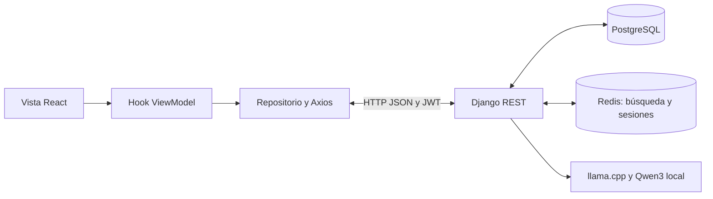

# Guía de preparación y defensa del Sprint 2 — Magallanes

Preparada el 27 de octubre de 2026 a partir del código y de las comprobaciones de la web. El guion principal dura aproximadamente 7 minutos; las fórmulas y preguntas son material de estudio, no texto para leer completo durante la exposición.

**Alcance:** Diego presenta servidor y web. Android corresponde a Angel/Rosales; su implementación ya tiene demostración automatizada en emulador dentro de la rama integrada. El documento vigente del Sprint 2 contiene 69 tareas; no debe confundirse con las 95 tareas del Sprint 1. Las 27 tareas exclusivas de Diego tienen implementación web/servidor; también se implementó el servicio de IA local y su configuración con autorización del usuario. Las tareas compartidas no quedan aceptadas en ambas plataformas solo por mostrar la web.

**Actualización del 27/10 después de integrar:** Android de Angel (`Rosales@18e4893`) está incorporado en la rama integrada mediante `b4a0ee3`. Se corrigieron los contratos de simulación/IA y el tiempo de espera del modelo. Se comprobaron 347 pruebas servidor, 77 web, 68 JVM y tres de interfaz en Pixel_7, incluyendo el recorrido real de los cinco pilares, puntaje, escenarios y ambos niveles de IA. Estado técnico: 66 tareas al 100 %; T65/T69 parciales y T66 pendiente por acuerdos y seguimiento reales del equipo. La matriz reconciliada está en `Sprint_2_avance_26_octubre.md`.

## 1. Demostración del Sprint 2

### Antes de entrar al aula

- Usar la carpeta `C:\Users\Magal\.codex\.chatgpt-projects\g-p-6acaed37aab8819194a2ca4d4594528c\Integracion_Sprint1`, rama `magallanes-sprint2-simulaciones`.
- Web: http://127.0.0.1:55183/login. API: http://127.0.0.1:58010/api/v1. El puerto del modelo local es 58110. Los puertos identifican servicios distintos de esta computadora, no páginas públicas de Internet.
- Si los servicios ya están funcionando, no reiniciarlos. Para preparar la demostración detenida, usar `tools/Start-LocalAI.ps1` y después `tools/Start-Sprint2-Demo.ps1`. Este último usa la base aislada `sprint2_completion_validation` y se detiene si los puertos de la web/API están ocupados. No ejecutar importaciones en otra base durante la presentación.
- Preparar una cuenta de exposición y ensayar el acceso. Para demostrar el registro, usar un usuario y correo que no estén registrados. No reutilizar una contraseña personal.
- Ensayar MSFT FY2024, los dos niveles de IA y la empresa AAPL sin datos. Una generación nueva del modelo local puede tardar alrededor de un minuto; una respuesta vigente en caché es más rápida.
- Dejar abiertos el código de pilares, simulaciones y sus ViewModels. En las herramientas de desarrollo mostrar una respuesta de pilares o simulación, no las credenciales ni tokens de acceso.

### Guion breve: acción, explicación y evidencia

| Tiempo | Qué hacer | Qué decir |
|---|---|---|
| 0:00–0:25 | Mostrar Inicio. | «Esta web permite explorar empresas y estudiar indicadores financieros históricos. En este Sprint implementamos cinco pilares, su radar y puntaje, simulaciones y una guía de interpretación con IA local». |
| 0:25–1:05 | Mostrar Crear cuenta; enviar vacío para ver validación. Completar una cuenta desechable o entrar con la preparada. | «Validamos en la web para orientar al usuario y nuevamente en Django para proteger los datos. El tipo de inversor es un perfil, no un permiso de administrador». |
| 1:05–1:35 | Explorar empresas: A–Z, sectores, filtro de indicadores. Abrir Microsoft. | «El catálogo tiene 503 símbolos de referencia. Microsoft es el caso completo de datos; las demás fichas indican lo que falta. El orden se aplica en el servidor antes de paginar». |
| 1:35–2:05 | Resumen: mostrar fecha del balance, fecha del cierre y abrir fuentes. | «Guardamos respuestas de SEC y Yahoo Finance. Un preparador selecciona hechos y fechas, calcula métricas y produce archivos de carga. Django los importa a PostgreSQL; abrir la pantalla consulta esa base, no descarga cotizaciones nuevas». |
| 2:05–3:25 | Salud financiera: FY2024, 85,25/100, radar; abrir Liquidez y una fórmula. Cambiar a FY2023 y regresar a último disponible. | «Los ratios salen de componentes del mismo ejercicio. Convertimos cada ratio en una nota con una regla académica publicada; cada pilar pesa 20 %. El resultado no es una probabilidad de ganancia. Cambiar el ejercicio solicita otros componentes; no cambia el histórico de precios». |
| 3:25–4:35 | Simulaciones: generar, mostrar P10/P50/P90, tabla y leyenda. Abrir ajustes, poner tasa y volatilidad en cero; generar y restablecer. | «Generamos 2000 trayectorias con el mismo motor y tomamos tres percentiles por fecha. Con tasa y volatilidad cero el precio queda constante. Restablecer usa el histórico y la semilla original. Ocultar una curva solo cambia su visibilidad». |
| 4:35–5:30 | Explicación de IA: generar, mostrar una cifra, explicaciones, fortalezas/riesgos; cambiar a Técnico. | «Qwen3 se ejecuta localmente y selecciona entre explicaciones financieras revisadas. Django calcula las cifras y fija sus referencias. Los niveles cambian el lenguaje, no los datos. No entrenamos un modelo propio ni presentamos esta guía como un asesor financiero». |
| 5:30–6:00 | Volver al explorador, comprobar la búsqueda conservada; abrir AAPL. | «Los filtros se conservan al volver. Una empresa del catálogo sin datos no recibe números ni gráficos inventados de Microsoft». |
| 6:00–7:00 | Mostrar código y un commit asociado a la tarea. | «La vista presenta; el ViewModel gestiona estado y acciones; el repositorio llama a la API. Django calcula y persiste. Cada tarea tiene trazabilidad con código, pruebas y commits; la cantidad de commits no tiene que ser igual a la cantidad de tareas». |

Si falta tiempo, demostrar el cambio de nivel de IA con respuestas ya preparadas y dejar el detalle de las fórmulas para preguntas. El orden del recorrido importa más que abrir todos los desplegables.

### Trazabilidad de lo que muestras

| Función | Tareas de servidor/web | Evidencia en pantalla |
|---|---|---|
| Liquidez | T01/T02 | Liquidez corriente y prueba ácida; componentes y fuente. |
| Rentabilidad | T05/T06 | ROE, ROA y margen neto. |
| Solvencia | T09/T10 | Pasivos sobre patrimonio y cobertura de intereses. |
| Eficiencia | T13/T14 | Rotación, días de inventario y serie anual disponible. |
| Crecimiento y radar | T17/T18 | Crecimiento anual/compuesto y cinco ejes. |
| Puntaje general | T21/T22 | Cinco notas, pesos y regla versionada. |
| Escenarios base, optimista, pesimista | T25/T26, T29/T30, T33/T34 | Tres percentiles de una ejecución común. |
| Parámetros y comparación | T37/T38, T41/T42 | Límites, restablecimiento, leyenda y tabla final. |
| Fuentes, resumen y pilares de IA | T45/T46, T49/T50, T53/T54 | Datos referenciados y explicaciones controladas. |
| Argumentos y lenguaje | T57/T58, T61/T62 | Fortalezas, riesgos y nivel sencillo/técnico. |
| Proveedor local | T67 | Qwen3 y llama.cpp preparados, con hashes de procedencia. |

Las tareas de prueba T04, T08, T12, T16, T20, T24, T28, T32, T36, T40, T44, T48, T52, T56, T60 y T64 cuentan con pruebas de servidor/web y Android y recorrido real en ambas plataformas. La aceptación del equipo sigue pendiente en T65/T66/T69. La matriz detallada está en [el avance auditado](C:/Users/Magal/.codex/.chatgpt-projects/g-p-6acaed37aab8819194a2ca4d4594528c/Integracion_Sprint1/docs/Sprint_2_avance_26_octubre.md).

### Lista de verificación: funciones, límites y pendientes

- [x] Pilares, fuentes y periodo; estados de carga, error y dato ausente.
- [x] Radar y puntaje; no usar cero para sustituir datos faltantes.
- [x] Simulaciones, semilla, límites, restablecimiento, leyenda y tabla.
- [x] IA local con vocabulario revisado, dos niveles y caché por contexto.
- [x] Búsqueda recuperable, filtros, reintento y orden alfabético.
- [x] Registro y acceso implementados y cubiertos por pruebas; ensayar el registro con una cuenta nueva antes de exponer.
- [ ] Cobertura financiera de todas las empresas: solo MSFT tiene el caso completo preparado.
- [ ] Referencia sectorial comparable: se muestra no disponible cuando falta muestra; no hay un ranking sectorial validado.
- [ ] Correo externo de recuperación: en la demostración el backend de correo es consola. Para entrega en un buzón se requiere SMTP configurado; el mensaje de solicitud no prueba entrega.

- [ ] Verificación completa de correo: existe `is_verified`, pero registrarse no demuestra un flujo de activación por correo terminado.
- [ ] Administración completa: el panel actual muestra un resumen; no una gestión completa de usuarios y datos.
- [x] Integración Android de escenarios/IA y recorrido real en emulador.
- [ ] Revisión conjunta de metodología (T65), Planning Poker real (T66) y seguimiento/burndown completo (T69).

La configuración del arranque de la demostración ya fija `FRONTEND_URL` a `http://127.0.0.1:55183`, para que los enlaces de recuperación apunten a esta web. Esto corrige el destino del enlace; no configura el envío SMTP.

## 2. Registro, validación y origen de los datos

### Cómo registrarse

1. En `/login`, elegir Crear cuenta.
2. Nombre y apellido son opcionales. Escribir usuario, correo, perfil y contraseña.
3. El usuario admite letras, números y guion bajo, con longitud de 3 a 150. La contraseña requiere al menos ocho caracteres, mayúscula, minúscula, número y símbolo. La confirmación debe coincidir.
4. Mostrar/ocultar solo cambia la visibilidad del campo; no envía el formulario. Los errores locales están en español y asociados al campo.
5. Crear cuenta envía JSON a `POST /api/v1/auth/register/`. El servidor comprueba unicidad de usuario/correo, formato y contraseña. `create_user` guarda un hash, no la contraseña en texto.
6. Si responde correctamente, devuelve usuario y tokens, se guarda la sesión y se abre Inicio. Los errores del servidor pueden aparecer después de superar las comprobaciones locales, por ejemplo si el usuario ya existe.

El registro no permite elegir `is_staff` o `is_superuser`. Inversor individual/institucional describe el perfil, no cambia los permisos. Una cuenta administrativa requiere asignación explícita en el servidor.

### De dónde sale la información y cómo llega a la pantalla

1. **Catálogo:** CSV del proyecto público `datasets/s-and-p-500-companies`. Se usa como referencia de símbolos, nombres y sectores; no como certificación oficial de composición actual emitida por S&P.
2. **Estados financieros:** hechos XBRL de SEC/EDGAR, publicados en informes anuales. Para los pilares se empaquetan ejercicios FY2020–FY2024, conservando componentes, periodo, moneda, etiqueta SEC y referencia del informe. La selección evita mezclar reexpresiones de informes diferentes dentro de un ejercicio.
3. **Precios:** snapshots de Yahoo Finance para Microsoft, con 1254 cierres ajustados hasta el 12/10/2026. Se utiliza SPY como referencia en el cálculo histórico de beta.
4. **Preparación:** [prepare_real_data.py](C:/Users/Magal/.codex/.chatgpt-projects/g-p-6acaed37aab8819194a2ca4d4594528c/Integracion_Sprint1/tools/prepare_real_data.py) lee JSON locales, selecciona el balance 2024, distingue cierres ajustados y no ajustados y calcula métricas derivadas. El ejercicio 2024 se eligió por disponer del gasto financiero anual necesario para la definición de EBIT usada en el proyecto.
5. **Carga:** `import_company_catalog`, `import_market_data` e `import_annual_financials` llevan CSV/JSON a PostgreSQL mediante comandos Django. `preload_search` prepara el índice Redis. Los archivos empaquetados y la procedencia están en [la descripción de los datos](C:/Users/Magal/.codex/.chatgpt-projects/g-p-6acaed37aab8819194a2ca4d4594528c/Integracion_Sprint1/docs/datos/README.md).
6. **Consulta:** React solicita JSON a Django. El servidor lee PostgreSQL, calcula los ratios y devuelve valor, unidad, periodo, estado y fuente. El cliente muestra el decimal formateado por el servidor.

Son datos históricos importados con procedencia. La simulación es sintética y la nota es una transformación académica; ninguna de las dos debe presentarse como un dato publicado por SEC o Yahoo. Los JSON originales completos permanecen en archivos locales fuera de Git; no todo el documento original se almacena como una tabla relacional.

**Dos fechas distintas:** el último cierre mostrado en el encabezado es de octubre de 2026; PER, capitalización y otros indicadores del resumen usan el balance/precio de referencia de 2024. No recalculamos PER dividiendo ese último cierre ajustado de 2026 entre un beneficio de 2024.

## 3. Implementación técnica y dónde está cada cosa



**MVVM en la web:** es una adaptación con hooks de React, no la clase ViewModel de Android. La vista representa estados y ejecuta acciones; el ViewModel coordina carga, errores y respuestas tardías; los repositorios encapsulan el acceso HTTP. El ORM de Django es otra capa, del lado del servidor. React no consulta PostgreSQL directamente.

| Módulo | Cómo funciona | Archivo para enseñar |
|---|---|---|
| Registro y acceso | React Hook Form/Yup orientan al usuario; DRF valida y Django guarda hashes. SimpleJWT emite acceso/renovación. | [Register.jsx](C:/Users/Magal/.codex/.chatgpt-projects/g-p-6acaed37aab8819194a2ca4d4594528c/Integracion_Sprint1/frontend/src/components/auth/Register.jsx), [serializers.py](C:/Users/Magal/.codex/.chatgpt-projects/g-p-6acaed37aab8819194a2ca4d4594528c/Integracion_Sprint1/backend/api/serializers.py). |
| Búsqueda | Estado en URL; filtros y orden en Django antes de paginar; autocompletado mediante índice Redis. | [useCompanySearchViewModel.js](C:/Users/Magal/.codex/.chatgpt-projects/g-p-6acaed37aab8819194a2ca4d4594528c/Integracion_Sprint1/frontend/src/viewmodels/useCompanySearchViewModel.js), [views.py](C:/Users/Magal/.codex/.chatgpt-projects/g-p-6acaed37aab8819194a2ca4d4594528c/Integracion_Sprint1/backend/api/views.py), [search_cache.py](C:/Users/Magal/.codex/.chatgpt-projects/g-p-6acaed37aab8819194a2ca4d4594528c/Integracion_Sprint1/backend/api/search_cache.py). |
| Pilares | Componentes anuales compatibles; Decimal para cálculos; ausencias y denominadores inválidos producen estado explícito. | [pillars.py](C:/Users/Magal/.codex/.chatgpt-projects/g-p-6acaed37aab8819194a2ca4d4594528c/Integracion_Sprint1/backend/api/pillars.py), [pillar_views.py](C:/Users/Magal/.codex/.chatgpt-projects/g-p-6acaed37aab8819194a2ca4d4594528c/Integracion_Sprint1/backend/api/pillar_views.py). |
| Notas y radar | Interpolación entre puntos académicos; promedio por pilar y pesos de 20 %. La web usa las notas del servidor. | [pillar_scoring.py](C:/Users/Magal/.codex/.chatgpt-projects/g-p-6acaed37aab8819194a2ca4d4594528c/Integracion_Sprint1/backend/api/pillar_scoring.py), [PillarRadar.jsx](C:/Users/Magal/.codex/.chatgpt-projects/g-p-6acaed37aab8819194a2ca4d4594528c/Integracion_Sprint1/frontend/src/components/company/PillarRadar.jsx). |
| Simulación | GBM/Monte Carlo, misma semilla e histórico, tres percentiles por fecha. Guarda usuario, configuración, snapshot y resultado. | [simulations.py](C:/Users/Magal/.codex/.chatgpt-projects/g-p-6acaed37aab8819194a2ca4d4594528c/Integracion_Sprint1/backend/api/simulations.py), [simulation_views.py](C:/Users/Magal/.codex/.chatgpt-projects/g-p-6acaed37aab8819194a2ca4d4594528c/Integracion_Sprint1/backend/api/simulation_views.py), [useSimulationViewModel.js](C:/Users/Magal/.codex/.chatgpt-projects/g-p-6acaed37aab8819194a2ca4d4594528c/Integracion_Sprint1/frontend/src/viewmodels/useSimulationViewModel.js). |
| IA | Qwen3 1.7B Q8_0 en llama.cpp CPU. JSON restringido a explicaciones revisadas; referencias y números fijados por Django. | [analysis_provider.py](C:/Users/Magal/.codex/.chatgpt-projects/g-p-6acaed37aab8819194a2ca4d4594528c/Integracion_Sprint1/backend/api/analysis_provider.py), [analysis_knowledge.py](C:/Users/Magal/.codex/.chatgpt-projects/g-p-6acaed37aab8819194a2ca4d4594528c/Integracion_Sprint1/backend/api/analysis_knowledge.py), [analysis_validation.py](C:/Users/Magal/.codex/.chatgpt-projects/g-p-6acaed37aab8819194a2ca4d4594528c/Integracion_Sprint1/backend/api/analysis_validation.py). |
| Conexión web | Axios añade Bearer JWT; el repositorio transforma la respuesta en datos del ViewModel. | [api.js](C:/Users/Magal/.codex/.chatgpt-projects/g-p-6acaed37aab8819194a2ca4d4594528c/Integracion_Sprint1/frontend/src/services/api.js), [companyRepository.js](C:/Users/Magal/.codex/.chatgpt-projects/g-p-6acaed37aab8819194a2ca4d4594528c/Integracion_Sprint1/frontend/src/models/companyRepository.js). |
| Persistencia | Usuarios, catálogo, componentes anuales, precios, historial, simulaciones y análisis validados. | [models.py](C:/Users/Magal/.codex/.chatgpt-projects/g-p-6acaed37aab8819194a2ca4d4594528c/Integracion_Sprint1/backend/api/models.py). |

**Caché:** Redis acelera búsqueda/autocompletado e interviene en revocación de sesiones. El análisis validado se conserva en PostgreSQL y se reutiliza hasta 24 horas con clave de empresa, contexto/periodo, procedencia, versión, modelo y nivel. La base sigue siendo la fuente de datos financieros; vaciar una caché no debe equivaler a borrar balances.

### Fórmulas que debes poder explicar

| Indicador | Fórmula o significado usado |
|---|---|
| Liquidez corriente | Activo corriente / pasivo corriente. Un valor 1,27 significa 1,27 unidades de activo corriente por una de pasivo corriente. |
| Prueba ácida | (Efectivo + inversiones de corto plazo + cuentas por cobrar) / pasivo corriente. No supone cero cuando falta un componente. |
| ROE / ROA | Beneficio neto / patrimonio promedio o activos promedio, respectivamente, por 100. Promedio = media de los dos cierres anuales. |
| Margen neto | Beneficio neto / ingresos por 100. |
| Pasivos sobre patrimonio | Pasivos totales / patrimonio contable; no debe llamarse deuda financiera sin aclarar esta definición. |
| Cobertura de intereses | EBIT aproximado / intereses. Aquí EBIT = resultado antes de impuestos + gasto por intereses del mismo informe. |
| Rotación de activos | Ingresos / activos totales promedio. |
| Días de inventario | Inventario promedio / costo de ventas anual por 365. Puede ser No aplica con una clasificación documentada. |
| Crecimiento anual | (Ingresos actuales / ingresos anteriores − 1) por 100. |
| Crecimiento compuesto | ((Ingreso final / ingreso de tres años antes) elevado a 1/3 − 1) por 100; exigimos cuatro cierres consecutivos comparables. |
| Puntaje general | 0,20 por la suma de cinco notas válidas. Sin una de las cinco no publicamos un promedio parcial. |

Las notas se calculan después de los ratios. Ejemplo: la regla de liquidez corriente asigna 50 puntos a 1 y 100 a 2; un ratio 1,5 recibe 75 puntos por interpolación. Los puntos son convenciones del proyecto, no umbrales universales ni parámetros aprendidos por IA. La tabla completa está en [las reglas versionadas](C:/Users/Magal/.codex/.chatgpt-projects/g-p-6acaed37aab8819194a2ca4d4594528c/Integracion_Sprint1/docs/Sprint_2_reglas_puntuacion.md).

**Monte Carlo:** usamos retornos logarítmicos de al menos 253 cierres válidos, hasta los 1261 más recientes. Estimamos tasa y volatilidad anuales y generamos 2000 trayectorias con 252 pasos anuales, resumidas en 13 puntos: origen y doce meses. GBM supone volatilidad constante y cambios multiplicativos. Los escenarios P10/P50/P90 salen del mismo conjunto de trayectorias, no de tres históricos diferentes. P50 es la mediana por fecha; P90 deja aproximadamente el 90 % de valores simulados por debajo, no implica 90 % de probabilidad de ganar. La semilla hace repetible el resultado con los mismos datos, versión y parámetros.

## 4. Preguntas del profesor y respuestas breves

| Pregunta | Respuesta que puedes defender |
|---|---|
| ¿Qué agregaste en el Sprint 2? | Cinco pilares con fuentes, radar y puntaje; simulaciones configurables y guía de IA local. Registro y exploración sirven de base e integración. |
| ¿Todo el Sprint está terminado? | Mi implementación web/servidor está preparada; Android ya está integrado y comprobado en emulador; el cierre requiere los acuerdos y registros reales de T65, T66 y T69. |
| ¿Cómo acreditas varias tareas con menos commits? | Muestro la matriz tarea–HU–archivo–prueba–commit. Un commit puede tocar varios archivos y una tarea puede necesitar correcciones posteriores; no se cuentan tareas solo por commits. |
| ¿Qué significa cierre ajustado? | Es el cierre histórico ajustado por el proveedor por eventos como dividendos y divisiones de acciones para comparar fechas. No es una cotización en vivo. |
| ¿Por qué existen 1M, 6M, 1Y y 5Y? | Solicitan uno/seis meses o uno/cinco años de precios hasta la fecha de consulta. No cambian el balance anual. Solo se devuelven las sesiones disponibles. |
| ¿Por qué el rango no llega a hoy? | El snapshot termina el 12/10/2026. No inventamos sesiones posteriores. Si el rango reciente queda vacío, puedo consultar otro rango con datos importados. |
| ¿De dónde salen los datos? | Catálogo CSV de referencia; componentes SEC/EDGAR y precios Yahoo Finance. Se transforman desde snapshots y se cargan en PostgreSQL con procedencia. |
| ¿Por qué elegiste 2024? | Ese ejercicio completo dispone del gasto financiero que usa nuestra definición de EBIT; no lo presentamos como balance de 2026. |
| ¿Por qué solo Microsoft tiene datos completos? | La cobertura cargada se limitó a ese caso verificable. El catálogo no equivale a cobertura de balances y precios para todos sus símbolos. |
| ¿Por qué 503 si el índice se llama 500? | Cargamos 503 símbolos del catálogo de referencia; símbolos y empresas no son necesariamente una correspondencia uno a uno por las clases de acciones. No afirmo certificar la composición oficial actual. |
| ¿Qué diferencia hay entre frontend y backend? | React presenta y gestiona interacción; Django valida permisos, consulta datos y calcula. Se comunican mediante JSON por HTTP. |
| ¿Usaste MVVM? | Sí, con vistas, hooks ViewModel y repositorios de acceso a datos. La lógica financiera está en el servidor. Puedo mostrar una acción de vista hasta su endpoint. |
| ¿Qué es una API? | El contrato de solicitudes y respuestas. Por ejemplo, GET companies/MSFT/pillars devuelve indicadores, periodos y fuentes; no una página HTML. |
| ¿Qué hace el ORM? | Traduce operaciones de modelos Django a consultas SQL y maneja relaciones. PostgreSQL sigue siendo el motor que almacena los registros. |
| ¿Qué guarda PostgreSQL? | Usuarios, empresas, componentes anuales, precios, historial, ejecuciones simuladas y respuestas validadas de IA. Los snapshots originales completos también existen como archivos locales. |
| ¿Para qué Redis? | Para acelerar búsqueda/autocompletado y apoyar revocación de sesiones. No reemplaza la base financiera. |
| ¿Cómo sabes que una fórmula usa el año correcto? | Cada componente tiene ejercicio, fechas y moneda. Verificamos cierres consecutivos y publicamos sus referencias con el resultado. |
| ¿Qué haces ante datos faltantes o divisor cero? | Devolvemos No disponible y su motivo. Cero es un valor distinto de ausencia. No aplica requiere una razón documentada. |
| ¿Por qué 85,25/100? | Es el promedio ponderado de cinco notas, cada una con peso 20 %, calculado sin redondearlas previamente. La regla académica está versionada y es reproducible. |
| ¿Esos pesos fueron validados científicamente? | No. Son una convención documentada del proyecto, pendiente de revisión del equipo; no afirmamos un modelo financiero universal. |
| ¿Puntaje general y Altman-Z son lo mismo? | No. El primero promedia notas de cinco pilares; Altman-Z es otra fórmula que combina ratios y tiene sus propias zonas. |
| ¿Qué es Altman-Z? | Una fórmula de clasificación que combina capital de trabajo, beneficios retenidos, EBIT, valor bursátil y ventas relativos a activos/pasivos. El uso aquí es académico, no un predictor validado para Microsoft. |
| ¿Por qué Altman-Z vale 9,93 si el medidor llega a 5? | La aguja limita la visualización a 0–5; el número conserva el valor calculado. No se recorta el cálculo. |
| ¿Qué significa volatilidad? | La variación de los retornos históricos; en el modelo determina la dispersión de las trayectorias, no una ganancia garantizada. |
| ¿Qué es GBM? | Movimiento browniano geométrico: un modelo de cambios multiplicativos del precio con tasa y volatilidad supuestas. Se usa para simular escenarios, no para conocer el futuro. |
| ¿Por qué no cambia al repetir? | Conservamos semilla, datos, parámetros y versión. Esa reproducibilidad permite comparar ajustes sin confundirlos con ruido aleatorio nuevo. |
| ¿Qué pasa si tasa y volatilidad son cero? | Cada paso multiplica por uno y el precio queda constante. Es una comprobación conocida del motor. |
| ¿P10 y P90 son la peor y mejor pérdida/ganancia? | No. Son percentiles de las simulaciones por fecha. Hay valores fuera de esos percentiles y no constituyen garantías del mercado. |
| ¿La IA es real o está entrenada por ustedes? | Hay inferencia local con Qwen3, que no entrenamos. Su salida está restringida a explicaciones revisadas; Django calcula las cifras. |
| ¿Por qué restringir el texto de IA? | Para evitar fórmulas confundidas o afirmaciones financieras sin respaldo. El esquema y el validador rechazan respuestas fuera del alcance admitido. |
| ¿Qué pasa si el modelo falla? | Se informa que el análisis no está disponible. Si la vista conserva un resultado válido anterior, queda identificado por nivel y periodo; no se presenta como una generación nueva. |
| ¿Cambiar de nivel cambia las cifras? | No. Cambian las formulaciones permitidas; el contexto financiero y las métricas siguen siendo los mismos. |
| ¿Un registro crea un administrador? | No. El perfil de inversor no equivale a permisos. El servidor controla la administración mediante is_staff/is_superuser. |
| ¿Cómo se guarda la contraseña? | Django crea un hash con el sistema de hash configurado; no se guarda el texto original ni se intenta descifrar al iniciar sesión. |
| ¿Qué es un JWT? | Un token firmado que acredita una sesión hasta su vencimiento. Firmado no significa cifrado; no debe contener secretos. |
| ¿Guardar tokens en localStorage es perfecto para producción? | No. Es la elección actual del prototipo y está expuesta a XSS. Un despliegue real requiere revisar cookies HttpOnly/Secure, CSRF, HTTPS y las demás amenazas. |
| ¿Ya se envía el correo al buzón? | En esta demostración el backend es consola. El flujo tiene pruebas de recuperación/SMTP local, pero no afirmo entrega externa sin configurar un proveedor SMTP. |
| ¿Qué limitaciones reconoces? | Cobertura de una empresa, comparación sectorial insuficiente, reglas académicas pendientes de revisión y validación en emulador que no cubre todos los dispositivos físicos, y acuerdos/seguimiento del equipo pendientes. |

## 5. Código y verificación de ordenamiento y altura

### Empresas y sugerencias: aplicado

En [views.py](C:/Users/Magal/.codex/.chatgpt-projects/g-p-6acaed37aab8819194a2ca4d4594528c/Integracion_Sprint1/backend/api/views.py), se admiten `name`, `-name`, `market_cap` y `-market_cap`. El valor predeterminado es `name`. La consulta filtrada se ordena antes de que DRF la pagine:

```python
if ordering in ('name', '-name'):
    alphabetical = Lower('name').desc() if ordering == '-name' else Lower('name').asc()
    return queryset.order_by(alphabetical, 'ticker')
```

El ticker desempata nombres iguales. No se ordenan solo las veinte tarjetas de una página. [search_cache.py](C:/Users/Magal/.codex/.chatgpt-projects/g-p-6acaed37aab8819194a2ca4d4594528c/Integracion_Sprint1/backend/api/search_cache.py) deduplica los candidatos del prefijo, los ordena por nombre y luego aplica el límite del autocompletado; la web presenta las opciones por nombre con `localeCompare` y mantiene la selección por teclado.

En la web: Explorar empresas → Ordenar por → Nombre: A–Z o Nombre: Z–A. La elección queda en la URL y se conserva al volver y recargar. Los ordenamientos anteriores por capitalización siguen disponibles.

### Sectores: aplicado sobre las etiquetas en español

En [useCompanyFiltersViewModel.js](C:/Users/Magal/.codex/.chatgpt-projects/g-p-6acaed37aab8819194a2ca4d4594528c/Integracion_Sprint1/frontend/src/viewmodels/useCompanyFiltersViewModel.js):

```javascript
setSectors([...(response.sectors || [])].sort((a, b) =>
  sectorLabel(a.value, a.label).localeCompare(
    sectorLabel(b.value, b.label), 'es', { sensitivity: 'base' }
  )
))
```

Se copia la lista para no mutar la respuesta. Se ordena Tecnología y no su valor interno `technology`. Todos los sectores permanece primero porque es la opción general, no un sector.

### Parte inferior y altura responsive: comprobado, sin recorte reproducido

Se pudo llegar al pie de Inicio, Explorador, MSFT y AAPL a 1440×600, 390×640 y 320×568. Son doce combinaciones; no se detectó desbordamiento horizontal y el pie quedó dentro del viewport tras desplazarse al final. La altura actual usa mínimos, no un `height: 100vh` fijo que limite el contenido:

```css
/* Reglas existentes, agrupadas aquí para explicar su función. */
body, #root, .workspace-shell, .auth-container {
  min-height: 100vh;
}
/* Las tablas grandes pueden desplazarse dentro de su propio bloque. */
.pillar-history, .scenario-table {
  overflow-x: auto;
}
```

No se añadió un `overflow: hidden` global para ocultar el problema. Si aparece en otra ventana: recargar la web actual, desplazar hasta el final, inspeccionar en DevTools el contenedor que recorta y quitar allí una altura máxima/fija o un overflow vertical oculto. Un patrón para un contenedor que se hubiera fijado por error es `height: auto; min-height: 100vh; min-height: 100dvh;`, preservando el desplazamiento normal del documento. No aplicarlo indiscriminadamente a gráficos o listas que necesiten su propio scroll.

### Comprobaciones que puedes enseñar

- Pruebas actuales: 77 frontend, 347 backend y 68 JVM Android aprobadas; tres pruebas de interfaz ejecutadas en emulador; compilación correcta. Los conteos se refieren a esta revisión, no sustituyen la demostración Android.
- Chrome: empresas por nombre en ambas direcciones, sectores en español, autocompletado, navegación y acceso al pie de página en ventanas bajas/móviles.
- Para consultar trazabilidad: `git log --all --oneline --grep="T25"` o sustituir por la tarea deseada. Mostrar también el archivo y una prueba; un mensaje de commit por sí solo no acredita aceptación.

### Consulta opcional de base de datos, solo lectura

En la base `sprint2_completion_validation`, estas consultas muestran catálogo, ejercicios y precios sin abrir datos de autenticación:

```sql
SELECT ticker, name FROM companies ORDER BY lower(name), ticker LIMIT 10;
SELECT fiscal_year, period_start, period_end, currency
FROM annual_financial_statements
WHERE company_id = (SELECT id FROM companies WHERE ticker = 'MSFT')
ORDER BY fiscal_year;
SELECT date, adjusted_close, source FROM price_history
WHERE company_id = (SELECT id FROM companies WHERE ticker = 'MSFT')
ORDER BY date DESC LIMIT 5;
```

En la defensa, primero muestra la acción en la web, después el archivo que la implementa y finalmente una prueba o consulta que la respalda. Eso demuestra comportamiento, implementación y evidencia en un recorrido concreto.
